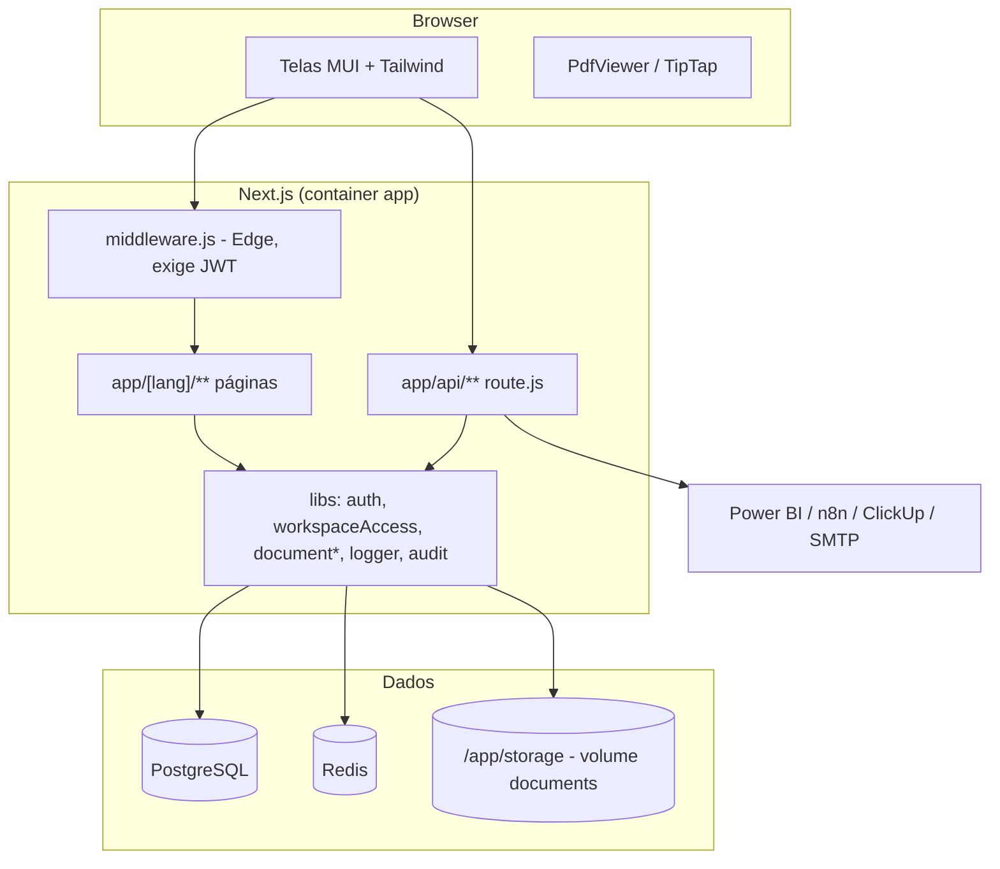
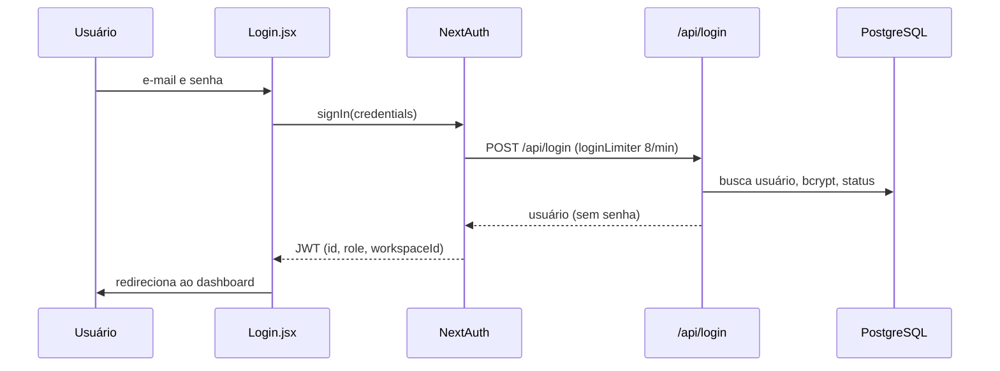
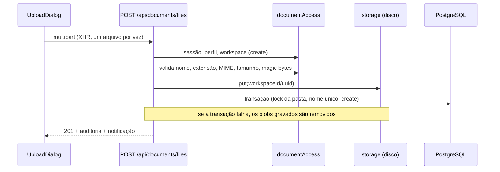

# Mapa do código

> Gerado pelo Cartographer em 2026-11-11T18:07:42Z. Os números de arquivos e tokens são estimados (bytes ÷ 4, sem imagens nem lockfile); cerca de 735 mil tokens são `src/assets` (ícones), que não foram lidos. O mapeamento foi feito por 3 subagentes que leram o código; os achados marcados com **(não verificado)** vêm só do relatório deles e devem ser conferidos antes de agir.

## Visão geral

**Simpla Insights** (nome do pacote: `dash-mui-nextjs-admin-template`): painel multi-workspace em cima do template MUI para Next.js. Entrega dashboards do Power BI (via iframe protegido), formulários que postam em webhooks do n8n e o módulo de **Documentos** (pastas, arquivos, documentos HTML e templates). A interface e as mensagens estão em português (pt-BR).

**Stack:** Next.js 16 (App Router, Turbopack, `output: 'standalone'`), React 19, JavaScript/JSX, MUI 7 + Tailwind 4, Prisma 6 + PostgreSQL 16, NextAuth 4 (JWT), Redis (rate limit), pino, valibot, nodemailer, TipTap 3, react-pdf. Deploy por Docker (EasyPanel).



## Estrutura de diretórios

```
.
├── eslint.config.mjs          Config flat do ESLint 9 (em preparação, ainda não commitada)
├── Dockerfile / docker-compose*.yml / docker-entrypoint.sh
├── DEPLOYMENT.md / README.md / .env.example
├── .github/workflows/ci.yml   CI: pnpm 10, install --frozen-lockfile, lint, build, /api/health
├── scripts/documents-dev/     mock (seed), smoke test e README (só ambiente local)
├── public/                    estáticos (docs/termos-de-uso.pdf, imagens)
└── src/
    ├── middleware.js          exige JWT; rotas públicas listadas na seção Autenticação
    ├── app/
    │   ├── [lang]/            páginas (br|en|fr|ar)
    │   │   ├── (blank-layout-pages)/  login, setup, accept-invite, termos, 401/404
    │   │   ├── (dashboard)/(private)/ dashboards, documents, apps/*, pages/account-settings
    │   │   ├── forms/         lista, edição, preenchimento, links
    │   │   └── f/[token]/     formulário público
    │   ├── api/               ~61 route.js (auth, apps/*, forms, documents, embed, audit...)
    │   └── server/actions.js  server actions (users, workspaces)
    ├── views/                 telas (apps, forms, documents, dashboards, root views)
    ├── components/            layout (Navbar, VerticalMenu...), pdf-viewer, auth, dialogs
    ├── libs/                  regras de negócio (auth, workspaceAccess, document*.js, storage...)
    ├── utils/                 roleHelpers, i18n, getDictionary
    ├── prisma/                schema, migrations, seed.js, modules.js
    ├── @core @menu @layouts   código do template (tema, menu vertical, layouts)
    ├── data/dictionaries/     br/en/fr/ar.json (só o namespace "navigation")
    ├── fake-db/ assets/       sobras do template e ícones (ignorar)
    └── configs/               themeConfig, i18n, primaryColorConfig
```

## Guia dos módulos

### Autenticação, papéis e escopo de workspace

**Entrada:** `src/libs/auth.js`, `src/middleware.js`, `src/utils/roleHelpers.js`, `src/libs/workspaceAccess.js`.

- **Papéis** (`User.role`): `superAdmin > subAdmin > admin > user`. `isHighAdmin` = superAdmin ou subAdmin. `user` recebe acesso fino por função personalizada (`CustomRole` + `RolePermission`).
- **Sessão:** NextAuth com JWT de 30 dias. O `authorize` chama `POST /api/login` do próprio app (por isso `API_URL` é obrigatória). O JWT leva `id, role, workspaceId, adminPermissions`, fixos até o próximo login.
- **Middleware (Edge):** sem JWT redireciona para `/login`, inclusive chamadas de API. Públicas: `/login`, `/register`, `/forgot-password`, `/reset-password`, `/setup`, `/accept-invite`, `/pages/termos-de-uso`, `/api/auth/*`, `/api/login`, `/api/setup`, `/api/health`, `/api/apps/users/accept-invite`, `/api/forms/*/submit`, `/api/forms/datasource` e `/f/*`. Não checa `status` do usuário (Prisma não roda no Edge); isso fica no `AuthGuard`, em `/api/auth/session-status` e nas rotas.
- **Workspace:** `Workspace.isPrivate` + `WorkspaceGuest(view|edit|create)`.

| Verificação | Quem passa |
|---|---|
| `canAccessWorkspace` (ver) | superAdmin; membros; convidados; highAdmin se o workspace não for privado |
| `canManageWorkspaceContent` (editar) | superAdmin; highAdmin no próprio workspace ou em workspace não privado; convidado `edit`/`create` |
| `canCreateWorkspaceContent` | igual, mas o convidado precisa de `create` |
| `canManageWorkspaceSettings` | superAdmin; highAdmin (próprio ou não privado); em privado, só convidado `create` |

- **Workspace ativo** do highAdmin: cookie/`localStorage` `activeWorkspaceId`, trocado pelo `WorkspaceSwitcher` e propagado pelo evento `workspace-changed`.

### Documentos (backend)

**Entrada:** `src/app/api/documents/**`, `src/libs/documentAccess.js`, `documentPermissions.js`, `documentFileTypes.js`, `documentHtml.js`, `documentHtmlRequest.js`, `documentPreview.js`, `storage.js`, `zipReader.js`.

- **Permissões:** `documentPermissions.js` é o único ponto de decisão por perfil (criar, editar e excluir = highAdmin; ver = qualquer logado). `documentAccess.js` combina perfil + regra de workspace em `ACTION_RULES` (`view/create/edit/delete`). Não há permissão por pasta ou arquivo: quem vê o workspace vê todos os arquivos dele.
- **Pastas:** lista de adjacência (`parentId`), profundidade máxima 10 (`MAX_FOLDER_DEPTH`, duplicada no cliente em `MoveDialog`), nomes únicos entre irmãos sem diferenciar maiúsculas, aplicados com `pg_advisory_xact_lock` + `assertNameAvailable`. Excluir apaga a subárvore em transação e depois os blobs.
- **Upload** (`POST /api/documents/files`, multipart): limite de 55 MB no corpo, 20 arquivos por envio, tudo ou nada. Valida nome saneado, extensão permitida, MIME do navegador e tamanho; confere magic bytes (`matchesFileSignature`) e grava com chave gerada no servidor (`<workspaceId>/<uuid>`). O `mimeType` guardado é sempre o canônico da extensão.
- **Tipos aceitos:** pdf, docx, xlsx, pptx, csv, txt, png, jpg, jpeg, webp, zip. `html` só nasce do editor (`uploadable: false`).
- **Tamanho:** `DOCUMENTS_MAX_FILE_SIZE_MB` (padrão 25, teto 50), limitado por `experimental.proxyClientMaxBodySize: '55mb'` (vale para toda a API).
- **Storage:** interface `put/get/delete/exists/generateStorageKey`, único driver em disco (`STORAGE_DIR`); `getDriver()` é o ponto de extensão para S3. A gravação usa `wx` (nunca sobrescreve).
- **Servir arquivos:** `streamDocumentFile` envia `nosniff`, `Cache-Control: private, no-store` e CSP própria (com `sandbox` para HTML). `/preview` só serve PDF e imagens; `/download` usa `attachment`; `/preview-data` devolve JSON estruturado (texto, tabela, documento, slides, arquivo, html), com limites em `PREVIEW_LIMITS` e leitor ZIP mínimo (sem ZIP64, sem criptografia, com proteção contra zip bomb).
- **Documentos HTML:** o cliente manda JSON do TipTap. O servidor limpa (`sanitizeHtmlDocumentContent`: nós e marcas permitidos, links só `http(s)`/`mailto`, até 20 mil nós e 1 MB), monta o HTML escapado dentro de um template (padrão Simplifica ou do workspace) e grava um blob novo a cada edição (troca `storageKey` e apaga o antigo). Templates são validados (`validateHtmlTemplate`) e só highAdmin os gerencia.
- **Auditoria:** `DOCUMENT_FOLDER_*`, `DOCUMENT_FILE_*` (incluindo `VIEW` e `DOWNLOAD`, deduplicados em 15 min), `DOCUMENT_HTML_*`, `DOCUMENT_TEMPLATE_*`.
- **Erros:** todo handler é exportado por `withDocumentErrorHandling` (500 genérico com `x-request-id`).

### Documentos (interface)

**Entrada:** `src/app/[lang]/(dashboard)/(private)/documents/page.jsx`, `src/views/documents/*`, `src/components/pdf-viewer/*`.

- `page.jsx` calcula `canCreate/canEdit/canDelete` no servidor; `DocumentsView` faz AND com `listing.permissions` da API.
- `DocumentsView`: estado `folderId`, página (50 por página), busca com debounce de 300 ms, modo lista/grade (guardado em `localStorage`), proteção contra respostas antigas (`requestSeq`) e reset no evento `workspace-changed`. A pasta aberta **não** vai para a URL.
- Diálogos: `NameDialog` (criar e renomear), `UploadDialog` (react-dropzone, um arquivo por requisição via XHR com progresso), `MoveDialog`, `DeleteDialog` (conta o conteúdo antes de excluir pasta), `PreviewDialog`, `HtmlDocumentEditorDialog` (TipTap, abas editar/prévia) e `HtmlTemplatesDialog`.
- `PreviewDialog`: PDF pelo `ClientPdfViewer` (`/preview`), imagem em ``, o resto via `/preview-data` renderizado em React (HTML num `iframe sandbox=''`). Download é botão separado.
- `ClientPdfViewer` carrega `PdfViewer` com `ssr:false`; use sempre o wrapper. O worker do pdf.js vem do próprio app (sem CDN). É somente leitura (sem imprimir e sem menu de contexto).
- Estilo: classes Tailwind em `src/views/forms/formStyles.js`, usado de fato por Formulários, Documentos e PdfViewer.

### Formulários

**Entrada:** `src/app/api/forms/**`, `src/views/forms/*`, `src/libs/form*.js`, `src/libs/datasources/*`.

- Formulários em JSON (13 tipos de campo) que enviam as respostas a um webhook do n8n (`Authorization: Bearer N8N_API_KEY`). O `webhookUrl` nunca vai ao cliente nas rotas autenticadas; fontes de dados dinâmicas são resolvidas no servidor por `formId + fieldId`.
- Acesso: highAdmin gerencia; `admin` vê o próprio workspace; `user` só os formulários concedidos por `RolePermission`. Há links públicos (`FormPublicLink`, temporários ou permanentes; só superAdmin revoga).
- Rate limit: envio 30/min, datasource 120/min.
- `address-lookup` chama o Nominatim direto do navegador, com fallback manual.

### Dashboards (Power BI)

- CRUD em `/api/apps/dashboards`. O iframe cadastrado precisa apontar para `https://app.powerbi.com`; `embedUrl` e `iframeCode` são removidos das respostas.
- O visualizador usa `<iframe src=/api/embed/dashboard/:id>`. Essa rota exige sessão, `Referer` do mesmo host, passa por `getAuthorizedDashboard`, aplica rate limit (60/min por IP e 120/min por usuário) e redireciona para o Power BI. Acessos bloqueados geram `EMBED_ACCESS_BLOCKED`.

### Usuários, funções, workspaces, auditoria, notificações

- **Usuários:** convite por e-mail (token de 7 dias), aceite com termos, reset de senha pelo admin, `AdminPermission` (só `share`).
- **Funções (`CustomRole`):** por workspace, com `RolePermission` por módulo e recurso.
- **Workspaces:** CRUD, privado com convidados (`view/edit/create`), integração ClickUp.
- **Auditoria:** duas telas (`audit-logs` = acessos, `audit-actions` = ações críticas) alimentadas por `/api/audit-logs/*`. `createAuditLog` redige campos sensíveis (incluindo e-mail) e engole falhas de escrita.
- **Notificações:** `/api/apps/notifications`, visibilidade por papel, janela de 14 dias.

### Camada de framework e UI compartilhada

- `@layouts` (casca), `@menu` (menu vertical, popouts com floating-ui) e `components/layout/*` (Navbar, Footer, `VerticalMenu`). O menu é montado em `VerticalMenu.jsx` com condições por papel; só os rótulos vêm do dicionário.
- **Tema:** `SettingsProvider` (cookie `simplifica-dashboards-settings`, que **prevalece** sobre `themeConfig`) + tema MUI com CSS variables; Tailwind 4 mapeia tokens para variáveis `--mui-palette-*`.
- **Tailwind é `!important` no projeto todo** (`globals.css`), então `sx` do MUI não sobrescreve utilitários.
- **i18n:** só 4 dicionários com o namespace `navigation`. Telas e mensagens estão fixas em português. RTL (árabe) funciona via `dir` + `stylis-plugin-rtl` + classes lógicas do Tailwind.

## Modelo de dados (Prisma)

| Modelo | Pontos principais |
|---|---|
| Workspace, WorkspaceGuest, WorkspaceIntegration | `isPrivate`, convidados com permissão, config de integração em JSON |
| User, Account, Session, PasswordResetToken, UserIntegration, AdminPermission | `role`, `status` (`pending/active/inactive`), `customRoleId`, token OAuth em texto puro |
| CustomRole, Module, RolePermission, Dashboard, DashboardVisibility | `RolePermission(customRoleId, moduleId, action, resourceId?)`; `DashboardVisibility` é legado |
| Form, FormPublicLink | campos em JSON, `allowedRoles` (ids), links temporários/permanentes |
| Notification, NotificationRead, NotificationDismiss | por usuário |
| AuditLog, ErrorEvent | logs e erros do front/servidor |
| DocumentFolder, DocumentFile, DocumentHtmlContent, DocumentHtmlTemplate | `storageKey @unique`, `DocumentHtmlContent` 1:1 com arquivo, template com `SetNull` |

Migrations: `init` → permissões de módulo e admin → workspace privado/convidados → link público permanente → documentos (pastas e arquivos, conteúdo HTML, templates). A migration `20260824151639_add_documents_module` está vazia. O entrypoint roda `prisma migrate deploy` (os docs que citam `db push` estão desatualizados).

## Inventário de API (resumo)

| Domínio | Rotas | Quem |
|---|---|---|
| Auth | `/api/auth/[...nextauth]`, `/api/login`, `/api/setup`, `/api/health`, `forgot/reset-password`, `activity`, `session-status`, ClickUp OAuth | públicas ou sessão |
| Conta | `/api/apps/account-settings[/change-password]`, `/api/users/[id]/integrations/[provider]` | próprio usuário |
| Usuários e funções | `/api/apps/users[/id|invite|accept-invite|reset-password|permissions]`, `/api/apps/custom-roles[/id]` | highAdmin para escrever |
| Workspaces | `/api/apps/workspaces[/id]`, `/api/workspaces/[id]/integrations/[provider]` | acesso ao workspace |
| Dashboards | `/api/apps/dashboards[/id]`, `/api/embed/dashboard/[id]`, `/api/audit/dashboard-view` | por dashboard |
| Formulários | `/api/forms[/id|submit|links|datasource|public/[token]]` | por papel e token |
| Documentos | `/api/documents`, `folders`, `files`, `html`, `html-templates` (+ `move`, `download`, `preview`, `preview-data`) | ver: workspace; escrever: highAdmin |
| Notificações e auditoria | `/api/apps/notifications`, `/api/audit-logs[/access|/admin]`, `/api/observability/error-events` | conforme papel |
| Legado | `/api/legacy/*` (dados do `fake-db`), `/api/apps/permissions`, `user-list` e `/api/pages/profile` (410) | sobras do template |

## Fluxo de dados

### Login



### Upload de documento



### Abrir um documento

`DocumentsView` → `PreviewDialog` → `/preview` (PDF e imagens, stream) ou `/preview-data` (JSON estruturado) → auditoria `DOCUMENT_FILE_VIEW` (uma por 15 min por usuário e arquivo).

## Convenções

- **Rota de API:** `getServerSession` → 401 → checagem de perfil (403) → valida o corpo (valibot, `parseBody`) → regra de negócio (muitas vezes em `$transaction`) → logger + auditoria + notificação → `jsonWithRequestId`. Nas rotas dinâmicas usa-se `await params`.
- **Logs:** pino com `requestId` e nomes de evento em kebab-case; `sanitizeMeta` mascara chaves com password, token, secret, authorization, cookie e email.
- **Respostas de erro:** `{ message }` na maior parte; o login devolve `{ message: [..] }`.
- **Estilo de código** (regras do ESLint do projeto): sem ponto e vírgula, aspas simples, 120 colunas, linha em branco antes de `return` e antes/depois de blocos multilinha, `import/order` com react, `next/**` e `@/**`.
- **Ícones:** classes Iconify `tabler-*`. **Eventos de janela:** `workspace-changed`, `forms-changed`, `dashboards-changed`.
- **Textos:** fixos em português nas telas; só o menu usa dicionário.

## Pontos de atenção

**Infra e repositório**
- `.npmrc` usa `node-linker=hoisted` e `shamefully-hoist=true`; o build standalone depende disso.
- `src/prisma/dev.db` (SQLite) e `src/assets/iconify-icons/generated-icons.css` estão versionados; o segundo consta no `.gitignore` e é regerado pelo `postinstall`, então aparece como modificado após instalar.
- `NEXT_PUBLIC_*` são embutidos no build da imagem (build args do compose).
- A pasta `tsx-0/` na raiz é lixo vazio do `tsx`, ignorada pelo ESLint.
- O Docker usa pnpm 9.15.9 e o CI usa pnpm 10. O `prisma` (CLI) está em 6.19.0 e o `@prisma/client` em 6.19.1.
- `modules.js` (registra o módulo `documents`) não roda no entrypoint nem no seed; é manual.
- Com `down -v` o compose apaga o banco **e** o volume `documents`.
- A pasta aberta em Documentos não fica na URL.

**Restrições do módulo de Documentos**
- Sem permissão por pasta ou arquivo; qualquer papel com acesso ao workspace vê, abre e baixa tudo.
- Excluir um workspace apaga as linhas de documentos mas **não** os blobs do disco **(não verificado)**.
- Atualizar um documento HTML não renomeia o arquivo quando o título muda **(não verificado)**.

**Segurança:** há notas de segurança internas fora do repositório (docs/SECURITY_NOTES.local.md, no .gitignore).

## Pendências de lint (a corrigir no futuro)

Estado depois do `eslint --fix` (ESLint 9.39.5, 2026-11-11): **2 erros e 36 avisos**. Nada disso foi corrigido no código de produção; as regras novas do `react-hooks` 7 (React Compiler) estão como `warn` em `eslint.config.mjs`.

**Erros (correção manual)**
- `@next/next/no-assign-module-variable`: [src/prisma/modules.js:30](../src/prisma/modules.js#L30) (variável chamada `module`).
- `import/order`: [src/views/ForgotPassword.jsx:54](../src/views/ForgotPassword.jsx#L54) (o `--fix` não consegue reordenar).

**`react-hooks/refs`, 10 avisos** (leitura de `ref.current` durante o render): [option-menu/index.jsx:86](../src/@core/components/option-menu/index.jsx#L86), [MenuButton.jsx:55,68](../src/@menu/components/vertical-menu/MenuButton.jsx#L55), [LanguageDropdown.jsx:73](../src/components/layout/shared/LanguageDropdown.jsx#L73), [ModeDropdown.jsx:83](../src/components/layout/shared/ModeDropdown.jsx#L83), [ShortcutsDropdown.jsx:96](../src/components/layout/shared/ShortcutsDropdown.jsx#L96), [UserDropdown.jsx:108](../src/components/layout/shared/UserDropdown.jsx#L108), [WebsiteAnalyticsSlider.jsx:181,183](../src/views/dashboards/analytics/WebsiteAnalyticsSlider.jsx#L181) (3 ocorrências).

**`react-hooks/set-state-in-effect`, 8 avisos** (`setState` direto dentro de `useEffect`): [useMediaQuery.jsx:15](../src/@menu/hooks/useMediaQuery.jsx#L15), [VerticalMenu.jsx:125](../src/components/layout/vertical/VerticalMenu.jsx#L125), [RoleCards.jsx:48](../src/views/apps/roles/RoleCards.jsx#L48), [DashboardManage.jsx:89,96](../src/views/dashboards/DashboardManage.jsx#L89), [PreviewDialog.jsx:36](../src/views/documents/PreviewDialog.jsx#L36), [FormsListView.jsx:188](../src/views/forms/FormsListView.jsx#L188), [Login.jsx:134](../src/views/Login.jsx#L134).

**`react-hooks/exhaustive-deps`, 6 avisos**: [FormFillView.jsx:88](../src/views/forms/FormFillView.jsx#L88) (5) e [FormLinksView.jsx:52](../src/views/forms/FormLinksView.jsx#L52).

**Diretivas `eslint-disable` sem efeito, 12 avisos** (o ESLint 9 avisa por padrão; mantidas de propósito): Autocomplete.jsx:10, MenuSection.jsx:58, SubMenu.jsx:308 e 400, VerticalNav.jsx:188 e 200, ActivityTracker.jsx:32, Navigation.jsx:89 e 95, formSanitize.js:22, permissions/index.jsx:148 e ProjectsTable.jsx:161.

## Guia de navegação

| Para... | Mexa em |
|---|---|
| Criar um endpoint de documentos | `src/app/api/documents/...`, usar `getAuthorizedDocumentItem`/`resolveDocumentsWorkspace`, exportar via `withDocumentErrorHandling`, auditar em `createAuditLog` e listar a ação em `audit-logs/admin/route.js` |
| Mudar quem pode criar, editar ou excluir documentos | só `src/libs/documentPermissions.js` |
| Permitir um novo tipo de arquivo | `src/libs/documentFileTypes.js` (tipo e MIME) + `FILE_SIGNATURES` em `documentAccess.js` + `documentPreview.js` se houver pré-visualização |
| Trocar o storage para S3 | `getDriver()` em `src/libs/storage.js` (mesma interface) |
| Alterar o limite de tamanho | `DOCUMENTS_MAX_FILE_SIZE_MB`; se passar de 50 MB, também `proxyClientMaxBodySize` e `DOCUMENTS_MAX_REQUEST_BYTES` |
| Mudar o schema | `src/prisma/schema.prisma` + `pnpm migrate`; no deploy o entrypoint roda `migrate deploy` |
| Adicionar item ao menu lateral | `src/components/layout/vertical/VerticalMenu.jsx` (+ chave em `data/dictionaries/*.json`) |
| Criar uma página autenticada | `src/app/[lang]/(dashboard)/(private)/<rota>/page.jsx` + view em `src/views/` |
| Testar o módulo de Documentos | `docker compose -f docker-compose.yml -f docker-compose.dev.yml run --rm tools pnpm documents:mock` e `... pnpm documents:smoke --storage=local` |
| Subir tudo localmente | `docker compose -f docker-compose.yml -f docker-compose.dev.yml up -d --build` (app em :3000, Mailpit em :8025) |
